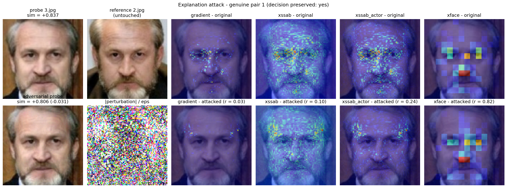
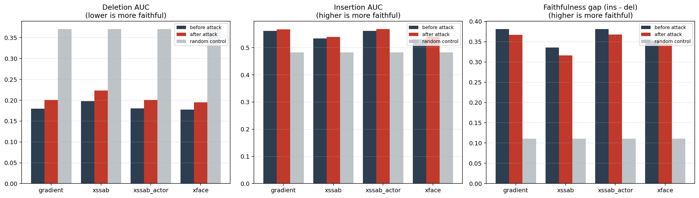
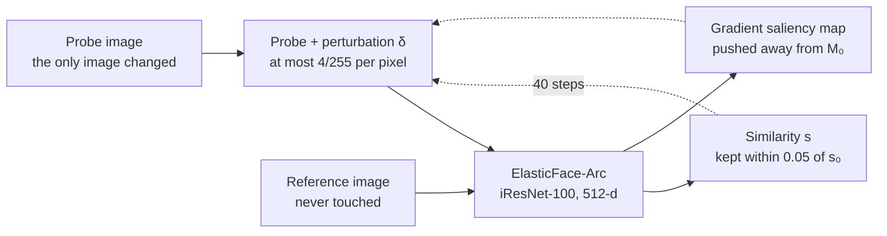

<div align="center">

<h1>Adversarial Manipulation of Explanations<br>in Face Verification</h1>

<p><strong>An attack on the explanation, not on the classifier.</strong></p>

<p>Can a small, imperceptible perturbation to one image of a verification pair keep the<br>
face-recognition decision intact while changing the saliency map that explains it?</p>

[](#about) [](report/Report.pdf) [](elastic_resnet.py) [](https://arxiv.org/abs/2109.09416) [](#dataset) [](#running-the-notebooks) [](https://github.com/xitij27/HCML-project/commits/main)

<p>
  <a href="#the-finding"><strong>The finding</strong></a>
  &nbsp;&nbsp;|&nbsp;&nbsp;
  <a href="#experiments">Experiments</a>
  &nbsp;&nbsp;|&nbsp;&nbsp;
  <a href="#running-the-notebooks">Run them</a>
  &nbsp;&nbsp;|&nbsp;&nbsp;
  <a href="report/Report.pdf">Report (PDF)</a>
  &nbsp;&nbsp;|&nbsp;&nbsp;
  <a href="RESULTS.md">All results</a>
</p>



<sub>Genuine pair 1. The attacked probe looks the same and its score moves only from 0.837 to 0.806, so the match stands.<br>
The gradient map the attack aimed at changes completely (r = 0.03), xSSAB partly (r = 0.10), its actor variant less (r = 0.24),<br>
and the gradient-free xFace map hardly at all (r = 0.82).</sub>

</div>

<br>

## The finding

Standard adversarial attacks in biometrics try to flip the decision. This one
must leave the decision alone and change only the explanation.

<table>
  <tr>
    <td align="center" width="25%" valign="top"><h3>100%</h3><sub>of decisions preserved, on 2,991 accepted genuine pairs, at all four operating points</sub></td>
    <td align="center" width="25%" valign="top"><h3>2.67/255</h3><sub>mean L<sub>∞</sub> change to one image of the pair (budget 4/255)</sub></td>
    <td align="center" width="25%" valign="top"><h3>75%</h3><sub>of the saliency map's hot-spots relocate, and map correlation falls to 0.236</sub></td>
    <td align="center" width="25%" valign="top"><h3>~89%</h3><sub>of the map's faithfulness is retained: it changed without becoming wrong</sub></td>
  </tr>
</table>

The decision and the similarity score can be held essentially fixed
(Δsim = +0.011, decision preserved 100%) while 75% of the saliency map's
hot-spots relocate and map correlation falls to 0.236. But the relocated map
retains **~89% of its faithfulness**. Two mechanisms set that ceiling:

- **Redundancy inside the face.** Eyes, nose bridge, mouth and jawline all
  carry identity, so the attack only reshuffles the ranking among informative
  pixels.
- **Invariance outside it.** ArcFace-trained networks ignore the background,
  so the input gradient there is near zero, and a ±4/255 perturbation cannot
  create sensitivity the model does not have.



<sub>Faithfulness before (dark) and after (red) the attack, against a random-saliency control (grey). The attacked bars barely move from the unattacked ones and stay far from the control.</sub>

> [!NOTE]
> With correlation alone, this would have been written up as a success on r = 0.236. The insertion and deletion evaluation is what separated "changed" from "became wrong". The supervisor's feedback changed the conclusion.

## How the attack works



The attack minimises a single loss, one gradient-descent step per iteration:

$$\mathcal{L} = \lambda_{\mathrm{pred}}\,\mathrm{relu}\big(|s - s_0| - \mathrm{tol}\big) + \lambda_{\mathrm{expl}}\,\rho\big(M_{\mathrm{att}}, M_0\big)$$

where $s_0$ and $M_0$ are the clean similarity and saliency map and $\rho$ is
Pearson correlation. The first term keeps the score where it was, in either
direction. The second moves the explanation. After each step the perturbation
is projected into the ε-ball and shrunk per sample if the score leaves the
band. The attacked map is then judged two ways: by its correlation with the
original, and by insertion and deletion curves, which ask whether the pixels
it now highlights still carry the match. The full method is in the
[report](report/Report.pdf).

## Experiments

| # | Experiment | What it establishes | GPU |
|---|---|---|---|
| 06 | [protocol-and-threshold](experiments/06-protocol-and-threshold/06-protocol-and-threshold.ipynb) | All 6,000 pairs; layout verified at *d* = 8.32; EER = 0.300% at τ = 0.2136; LFW 10-fold 99.80% ± 0.25% | ~5 min |
| 07 | [xai-faithfulness](experiments/07-xai-faithfulness/07-xai-faithfulness.ipynb) | Insertion/deletion over all 6,000 pairs, 3 methods + random floor | ~47 min |
| 08 | [decision-attacks](experiments/08-decision-attacks/08-decision-attacks.ipynb) | FGSM/I-FGSM both directions, 100% success at 4/255, all signs correct | ~50 min |
| 09 | [explanation-attack](experiments/09-explanation-attack/09-explanation-attack.ipynb) | **Main contribution:** decision fixed, map moved, faithfulness measured before vs after | ~105 min |
| 10 | [results-and-discussion](experiments/10-results-and-discussion/10-results-and-discussion.ipynb) | Cross-experiment figures and tables | none |
| 11 | [attack-diagnostics](experiments/11-attack-diagnostics/11-attack-diagnostics.ipynb) | Why the attack has a ceiling: score-band sweep, saliency relocation, direct faithfulness objective | ~28 min |

Every final number, with the notebook it comes from, is in
[RESULTS.md](RESULTS.md).

> [!NOTE]
> Legacy notebooks `01`–`05` in [`experiments/legacy/`](experiments/legacy/) are kept unchanged as the reviewed record. `03` contains a gradient-ascent sign bug (`flip_rate = 0.00` everywhere); `04` fixed the sign but ran genuine pairs only; `05` used a `grad × input` stand-in for xSSAB. All are superseded by `06`–`11`.

## Repository layout

| Path | Contents |
|------|----------|
| [`report/`](report/) | The final report: [`Report.pdf`](report/Report.pdf) (3-page IEEE-format writeup, with appendices), `main.tex`, `refs.bib` and `figures/` |
| [`RESULTS.md`](RESULTS.md) | Every final number, in tables |
| [`experiments/06-…/` to `11-…/`](experiments/) | One folder per experiment: its notebook, an `outputs/` directory (CSV, JSON, NPZ) and a `figures/` directory (PNG) |
| [`experiments/legacy/`](experiments/legacy/) | Notebooks `01`–`05`, superseded |
| [`elastic_resnet.py`](elastic_resnet.py) | iResNet-100 backbone (inlined into each notebook) |
| [`references/ElasticFace_paper.pdf`](references/ElasticFace_paper.pdf) | The ElasticFace paper |

Output files keep their `NN_` prefix so they stay unambiguous if they are ever
collected into one folder, which is what notebook 10 expects.

## Running the notebooks

You need a CUDA GPU. The notebooks were run on Kaggle.

**1. Get the model weights and the images.** Large files are not tracked (see
[.gitignore](.gitignore)). The weights (`ElasticFaceArc.pth`) and the LFW
image set (`imgs/`) come from:

```
https://owncloud.fraunhofer.de/index.php/s/OoLxFvESM9aUkR9
```

On Kaggle, upload them as a dataset and point `IMAGES_DIR` / `WEIGHTS_PATH` at
the attached path.

**2. Install the dependencies.** All are preinstalled on Kaggle.

```bash
pip install torch torchvision numpy opencv-python matplotlib Pillow pandas scipy
```

**3. Run `06` to `09` and `11`, in any order.** Each is self-contained: it
inlines the backbone and recomputes the 12,000 embeddings in about 40 s.

**4. Run `10` last.** It is the only notebook that consumes upstream artifacts.
Attach the `outputs/` of `06`–`09` as a Kaggle Dataset, or via *Add Input →
Notebooks* if those notebooks were committed. Its loader searches
`/kaggle/input` recursively and matches both `thresholds.json` and
`06_thresholds.json`.

> [!TIP]
> Every notebook has a `MAX_PAIRS` (or `DIAG_PAIRS`) knob. Set it to a few hundred for a smoke test before committing to a full run.

> [!NOTE]
> All notebooks use every visible GPU. On Kaggle's *GPU T4 x2* that roughly halves wall time. Set `N_GPUS = 1` to force a single device.

## Dataset

**12,000 images = 6,000 pairs**, not the 900 assumed in the original project
brief and notebooks `01`–`05`. Images are named sequentially (`0.jpg`,
`1.jpg`, …), 112×112, pre-aligned; consecutive images form a pair. The layout
is standard **LFW view-2**: 10 folds × 600 pairs, each fold being 300 genuine
followed by 300 imposter.

```python
is_genuine(pair) = (pair % 600) < 300     # 3,000 genuine, 3,000 imposter
fold(pair)       = pair // 600            # 10 folds
```

Notebook `06` verifies this empirically before anything is built on it.

**Probe and reference.** Every pair is split into a *probe*, the single image
an attack may modify, and a *reference*, never touched. The split is asserted
pairwise, and with `PROBE_SIDE="random"` the probe is chosen by a seeded
per-pair coin flip, so the attacked image is not systematically image 0 while
the run stays reproducible.

## Limitations

> [!IMPORTANT]
> The attack is white-box, with full gradient access, and digital only: no black-box or cross-model transfer, and no JPEG re-compression, resizing or print-scan robustness was tested. It uses one model and one dataset, and LFW is near-saturated. Only accepted genuine pairs were attacked. The full list is in [RESULTS.md, section 8](RESULTS.md#8-limitations).

> [!WARNING]
> In `11-attack-diagnostics-c-fix.ipynb` only the mask cell and Part C were re-run, so Parts A, B and D show stale output. The correct values are tabulated in [RESULTS.md, section 9](RESULTS.md#9-known-issues-in-the-executed-notebooks).

## Key references

- **ElasticFace:** Boutros et al., CVPRW 2022 · https://arxiv.org/abs/2109.09416 · [code](https://github.com/fdbtrs/ElasticFace)
- **xSSAB:** Huber et al., WACV 2024 · https://arxiv.org/abs/2304.13409 · [code](https://github.com/marcohuber/xSSAB)
- **xFace:** Knoche et al., [WACVW 2023](https://openaccess.thecvf.com/content/WACV2023W/XAI4B/html/Knoche_Explainable_Model-Agnostic_Similarity_and_Confidence_in_Face_Verification_WACVW_2023_paper.html) · [code](https://github.com/Martlgap/x-face-verification)
- **RISE / insertion–deletion:** Petsiuk et al., BMVC 2018. The faithfulness metric used in `07`, `09` and `11`
- Dombrowski et al. 2019, *Explanations can be manipulated and geometry is to blame* (NeurIPS)
- Heo et al. 2019, *Fooling Neural Network Interpretations via Adversarial Model Manipulation* (NeurIPS)
- Adebayo et al. 2018, *Sanity Checks for Saliency Maps* (NeurIPS)

## About

A bonus project by Kshitij Parashar for the Human and Identity Centered
Machine Learning (HCML) project, 2026.

<br>

<div align="center">
<sub><a href="#the-finding">The finding</a> &nbsp;|&nbsp; <a href="#experiments">Experiments</a> &nbsp;|&nbsp; <a href="#running-the-notebooks">Run them</a> &nbsp;|&nbsp; <a href="report/Report.pdf">Report</a> &nbsp;|&nbsp; <a href="RESULTS.md">All results</a> &nbsp;|&nbsp; <a href="https://github.com/xitij27/HCML-project/issues">Issues</a></sub>
</div>
