# Adversarial Manipulation of Explanations in Face Verification


## Abstract

Saliency maps are increasingly offered alongside face verification decisions on the argument
that a human reviewer can inspect the machine's reasoning and catch its mistakes. We ask
whether that safeguard can be defeated: can an imperceptible perturbation to one image of a
pair leave the verification decision intact while making the explanation misleading?

We find that the decision is trivially preservable and the explanation is easy to *move*:
an L∞ ≤ 4/255 perturbation holds the similarity score to within ±0.026 while relocating 75%
of the saliency map's hot-spots and driving map correlation to 0.236. But when we evaluate
the attacked explanation with insertion and deletion curves rather than map correlation, it
retains **89% of its faithfulness**: the pixels it now highlights still carry the match.

We diagnose why. Widening the score constraint by 10× (which removes the perturbation
constraint entirely) still reaches only 21.5% of the way to a random-saliency floor, and the
marginal returns saturate. An objective that directly rewards pointing at background does
better than decorrelation (1.24×, p = 0.014) but cannot push saliency mass past 0.57 of the
no-preference level. Two mechanisms explain the ceiling: **redundancy** inside the face,
where the attack merely swaps one identity-bearing region for another, and **invariance**
outside it, where the model has no gradient to exploit.

The methodological consequence is the more important result. On correlation alone, this run
would have been reported as a successful attack. It is not one, and only a faithfulness-based
evaluation reveals the difference.

---

## 1. Motivation

Face recognition is deployed where the consequences of error are severe: border control,
forensic casework, evidence in court. Explainability methods such as xFace [3] and
xSSAB [2] are proposed for exactly these settings, on the argument that a saliency map lets
a human auditor verify that the system attended to the right evidence.

That argument has an unexamined premise: it assumes the explanation is *trustworthy in the
same way the decision is not*. But a saliency map is another model output computed from the
same weights and the same input, and adversarial fragility of explanations has been
demonstrated for image classifiers [5, 6]. If the same holds for face verification, an
explanation is not an independent check; it inherits the vulnerability of the thing it is
meant to audit, while appearing more trustworthy because it is legible.

**The threat model.** A verification system reports *"same person"* and shows a saliency map
justifying it. An adversary who can modify **one** of the two submitted images adds a
perturbation that (i) leaves the decision and the similarity score essentially unchanged, and
(ii) makes the explanation point somewhere misleading. The auditor sees a normal decision
with a fabricated justification. This is realistic wherever image files are submitted and
later reviewed; it is *not* a threat to live camera capture.

Note the asymmetry with standard adversarial attacks on biometrics: those try to flip the
decision. Here the decision must survive untouched; it is the explanation alone that is
under attack.

---

## 2. Setup

**Model.** ElasticFace-Arc [1], an iResNet-100 producing 512-d embeddings; similarity is
cosine of the L2-normalised embeddings.

**Data.** LFW view-2: 12,000 images forming 6,000 consecutive pairs, arranged as 10 folds of
600 with each fold being 300 genuine followed by 300 imposter pairs. We verified this layout
rather than assuming it: under the assumed labelling the two score distributions separate at
Cohen's *d* = 8.32, while two competing hypotheses collapse to *d* ≈ 0.01, and the separation
holds independently in every fold.

**Probe and reference.** Each pair is split into a **probe**, the single image an attack may
modify, and a **reference**, which is never touched. The split is asserted pairwise and
chosen by a seeded per-pair coin flip, so the attacked image is not systematically image 0
(49.8% / 50.2%), and probe ∪ reference covers all 12,000 images exactly once.

**Operating point.** Rather than choosing a threshold by hand, we derive it: the Equal Error
Rate is **0.300% at τ = 0.2136**, and we additionally report at FMR = 10⁻¹, 10⁻² and 10⁻³
throughout so that no conclusion rests on a single operating point.

**Sanity of the whole pipeline.** Under the standard LFW 10-fold protocol (threshold fitted
on nine folds, applied to the held-out one) we obtain **99.800% ± 0.246%**, matching the
figure published for ElasticFace-Arc. That number can only come out right if the weights,
the preprocessing *and* the pair labelling are simultaneously correct, so it validates
everything downstream.

Of the 3,000 genuine pairs, **2,991 are accepted** at τ; these form the attack population.

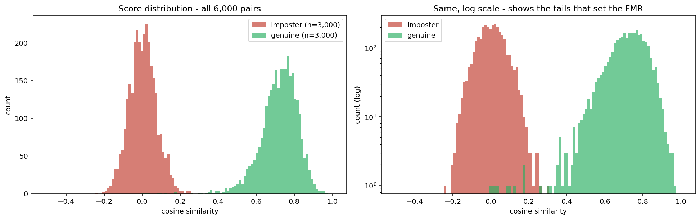

**Figure 1.** Genuine (green) and imposter (red) cosine-similarity distributions over all
6,000 pairs, linear and log scale. The log panel is the one that matters: with 3,000 imposter
scores the tail is resolved well enough to estimate a false match rate, which 900 pairs could
not support.

---

## 3. Are the explanations faithful to begin with?

Before asking whether an attack can corrupt an explanation, two things must exist: a
measurement of how good the explanation is initially, and a **floor** telling us what "no
information" scores. Without the floor, a post-attack number has no scale.

**Method.** We use insertion and deletion curves [4], adapted to verification. Both perturb
the probe and track cosine similarity to the untouched reference, in the order the saliency
map ranks pixels:

- **Deletion.** Replace the most salient pixels with mid-grey. A faithful map destroys the
  match early, so **low AUC is good**.
- **Insertion.** Restore the most salient pixels over a blurred probe. A faithful map
  rebuilds the match early, so **high AUC is good**.

We evaluate four maps over all 6,000 pairs: the squared input-gradient, our implementation of
xSSAB [2], xFace occlusion [3], and uniform noise as the control.

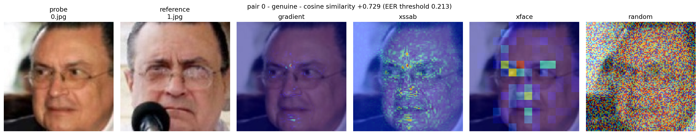

**Figure 2.** The four maps on genuine pair 0 (similarity +0.729). Probe `0.jpg` and reference
`1.jpg` are different photographs; only the probe is ever modified. Gradient is pixel-sharp
and sparse, xSSAB denser and more semantic, xFace blocky because it is grid-based, and the
random control is structureless. All three real methods concentrate on the face interior.

**Results** (genuine pairs, n = 3,000):

| method | deletion AUC ↓ | insertion AUC ↑ | gap ↑ |
|---|---|---|---|
| gradient | 0.1793 | 0.5597 | **0.3803** |
| xFace | 0.1772 | 0.5287 | 0.3516 |
| xSSAB (combined) | 0.1971 | 0.5319 | 0.3349 |
| **random (floor)** | **0.3698** | **0.4806** | **0.1108** |

Every real method separates decisively from noise: gradient beats random at **Cohen's
d = 3.44**, an order of magnitude larger than any difference *between* methods (d = 0.16 to
1.14). The implementation validates on its endpoints: all four methods share identical curve
endpoints (deletion 0.7196 → 0.0019, insertion 0.0272 → 0.7196), because those are properties
of the start and end states and only the path between them differs.

**Two findings worth carrying forward.**

*Insertion is a weak discriminator here.* Random insertion already reaches 0.481 because
restoring any half of the pixels over a blurred baseline recovers most of the similarity.
The usable headroom is 0.08 for insertion against 0.19 for deletion, so attacks should be
judged on **deletion**.

*Imposter pairs are degenerate for this metric.* With base similarity 0.003 there is almost
no match evidence to localise and all curves are near-flat. xFace is the informative
exception: its deletion AUC goes **negative (−0.076)**, dipping to −0.123 after 20% of pixels
are removed, because it correctly identifies the few regions supplying positive evidence.
This is the metric behaving correctly on a question that is ill-posed, and it is why the
attack targets accepted genuine pairs.

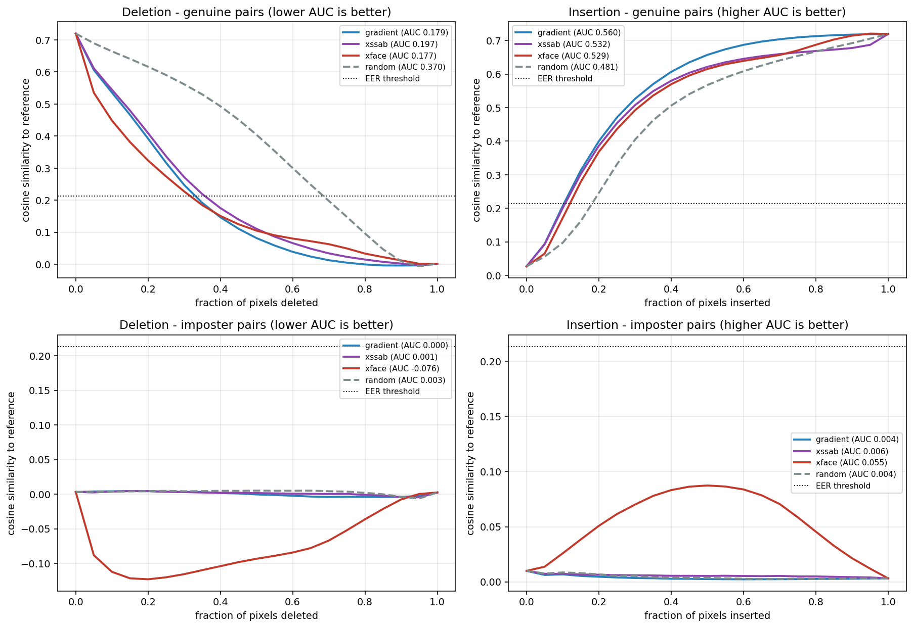

**Figure 3.** Mean curves over all 6,000 pairs, genuine (top) and imposter (bottom). For
genuine pairs every real method drops far faster than random under deletion and rises faster
under insertion. The imposter row shows the degeneracy discussed above: with almost no match
evidence to localise, all curves collapse toward zero.

---

## 4. Warm-up: attacking the decision

Before claiming an attack *preserves* a decision, the pipeline must be able to *break* one on
purpose. We run FGSM and I-FGSM in both directions over all 6,000 pairs: obfuscation on
genuine pairs (similarity must fall below τ), impersonation on imposter pairs (must rise
above it).

At **4/255 with I-FGSM, both directions reach 100%** with zero failures across 2,991 accepted
genuine and 2,990 rejected imposter pairs: mean Δsim −1.116 and +0.691 respectively. Success
holds at ~100% across every operating point from FMR = 10⁻¹ to 10⁻³.

An asymmetry appears at low budget: impersonation succeeds on 62.4% of pairs at 1/255 against
only 6.7% for obfuscation. Two competing effects produce this. Obfuscation displaces the
score **more** per unit of perturbation (1.18× at 1/255, rising to 1.73× at 8/255): pushing
an embedding *away* from a point is easier than steering it *toward* one. But obfuscation has
**2.41× further to travel**, because τ = 0.2136 sits close to the imposter mean (gap 0.210)
and far from the genuine mean (gap 0.506). The second effect dominates.

This is worth stating because it shows attack success rates are as much a statement about
*where the operating threshold sits* as about the attack itself, which is why the threshold
had to be derived before any of this could be interpreted.

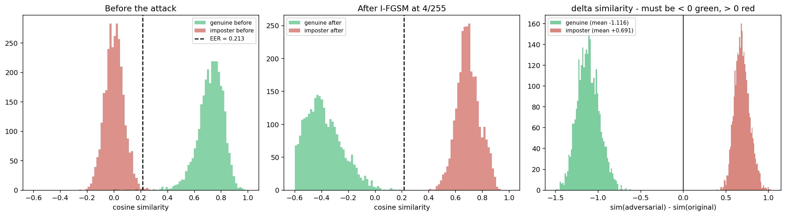

**Figure 4.** I-FGSM at 4/255. The two populations swap sides of the threshold completely:
genuine scores fall from ~+0.72 to ~−0.40 and imposter scores rise from ~0.00 to ~+0.69. The
right panel is the direction check: genuine Δsim must be negative and imposter positive, and
the two distributions do not overlap zero.

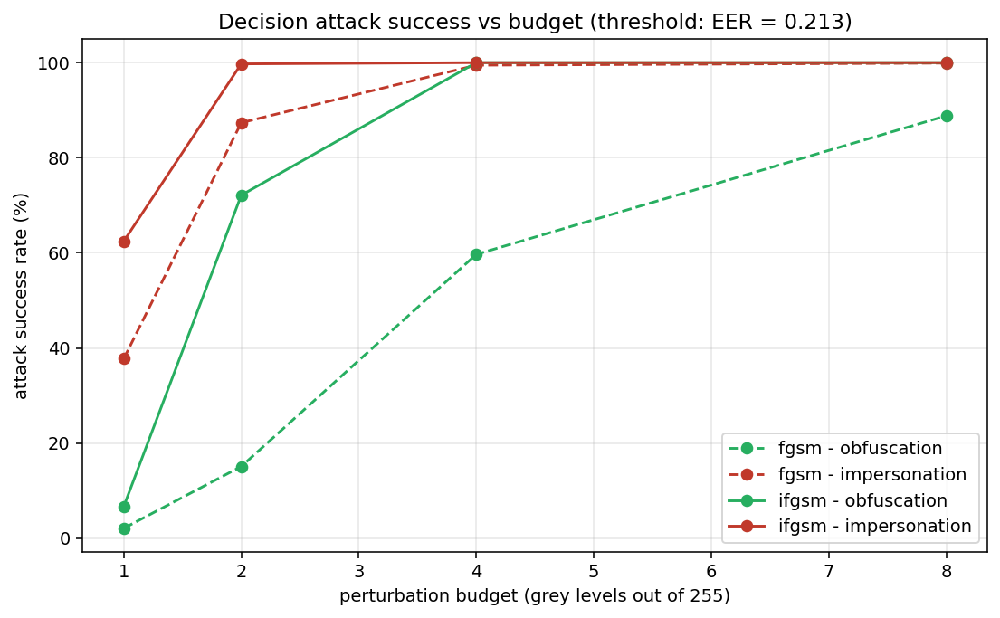

**Figure 5.** Success rate against budget, both attacks and both directions, at the EER
threshold. Impersonation (red) dominates at small budgets despite obfuscation displacing the
score further per unit of ε; the threshold simply sits closer to the imposter distribution.
Both saturate at 4/255.

---

## 5. The explanation attack

**Objective.** A single loss to minimise, one gradient-descent step per iteration:

```
L  =  λ_pred · relu(|sim − sim₀| − tol)          keep the score where it was
   +  λ_expl · pearson(map_attacked, map_original)    move the explanation
```

The decision term is **two-sided**: it penalises the score for moving in *either* direction,
not merely for falling below a floor. This matters: a one-sided floor lets the attack push
similarity *upward*, which preserves the decision but reads as a bug and weakens the claim.
After each step the perturbation is projected into the ε-ball and then shrunk per-sample if
the score leaves the band.

The explanation term is Pearson correlation rather than MSE because correlation is
scale-invariant: doubling every value of a map produces a large MSE while leaving the pattern,
and hence what a reviewer sees, completely unchanged.

**Setup.** 2,991 accepted genuine pairs, ε = 4/255, 40 steps, tol = 0.05.

### 5.1 The decision survives

- mean Δsim **+0.0110**, mean |Δsim| **0.0261**, 95% of pairs below 0.0474
- **decision preserved on 100% of pairs at all four operating points**
- mean L∞ **2.67/255**, well inside the invisible budget

The score does not merely stay on the correct side of a line; it stays where it was.

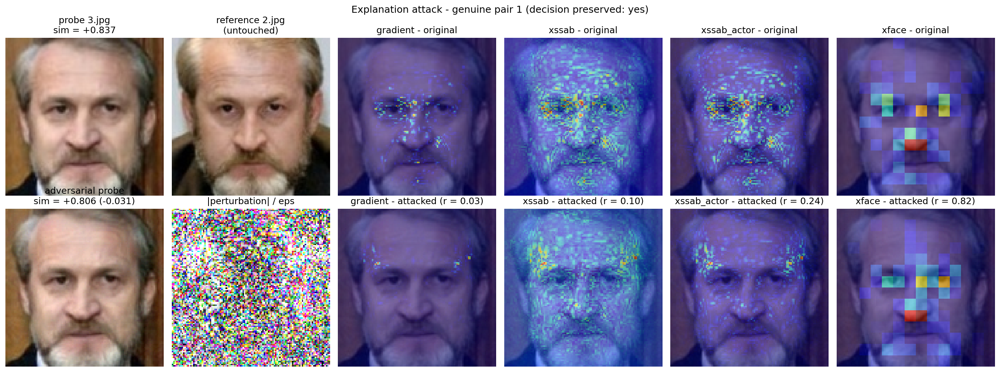

**Figure 6.** The attack on genuine pair 1. Probe `3.jpg` is modified, reference `2.jpg` is
not; the two probe images are indistinguishable and the score moves 0.837 → 0.806. Reading
the maps left to right shows the transfer staircase in a single pair: the targeted gradient
map is destroyed (r = 0.03), xSSAB partly (r = 0.10), the actor variant less (r = 0.24), and
the gradient-free xFace map is essentially untouched (r = 0.82).

### 5.2 The map moves a great deal

- Pearson correlation with the original: **0.236** mean, **0.128** median; 38.8% of pairs
  below 0.1, 75.7% below 0.3
- top-10% hot-spot overlap **0.253**, so **75% of the originally-hottest pixels relocate**

By any map-comparison metric, the reviewer is shown a different explanation of a decision
that has not moved.

### 5.3 But the map does not become wrong

| method | deletion AUC | → random floor (0.370) | faithfulness retained |
|---|---|---|---|
| gradient (attacked) | 0.1799 → 0.2007 | **10.9%** | ~89% |
| xSSAB | 0.1976 → 0.2232 | 14.9% | ~91% |
| xssab_actor | 0.1801 → 0.2005 | 10.8% | ~95% |
| xFace | 0.1777 → 0.1952 | 9.1% | ~97% |

The rise is overwhelmingly significant (p ≈ 1e-221 at n = 2,991) but small. Insertion barely
moves and if anything drifts the wrong way, consistent with §3's finding that insertion has
little headroom here.

Two pieces of evidence show this is a real mechanism rather than noise: per pair, the amount
the map moved predicts the faithfulness lost (**r = −0.347**, p ≈ 1e-85), and on the 200
most-disrupted pairs deletion AUC rises 0.225 → 0.282, nearly three times the average.

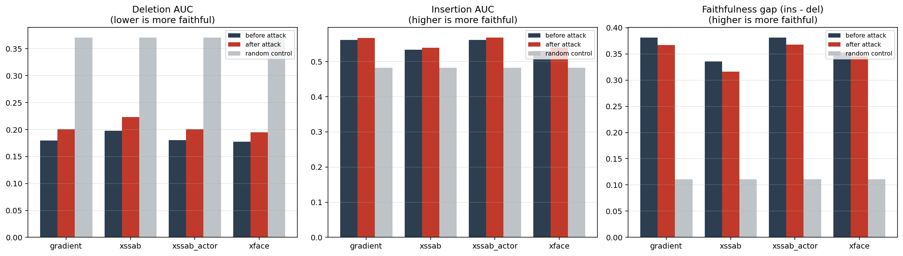

**Figure 7.** The central figure of the study. For each method: unattacked (dark), attacked
(red), and the random-saliency control (grey). The attacked bars barely move from the
unattacked ones and remain far from the control: the explanation changed, but it did not
become uninformative. Insertion (middle) moves so little that it is visually flat, consistent
with its narrow headroom.

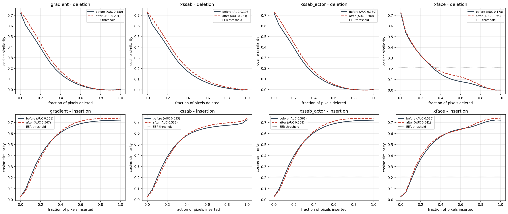

**Figure 8.** The same result as curves rather than areas. The attacked deletion curves
(dashed red) sit only slightly above the unattacked ones (solid), and the gap closes entirely
past ~60% of pixels deleted. A successful attack would have lifted the dashed curve toward a
straight diagonal.

**So the attack scrambles what the map looks like without substantially destroying what it
knows.**

### 5.4 Transfer

| explanation | correlation after attack |
|---|---|
| gradient (attacked) | 0.236 |
| xSSAB (combined) | 0.341 |
| xssab_actor | 0.458 |
| xFace (gradient-free) | **0.720** |

A monotone staircase rising with distance from the map the attack optimised. **This attacks a
*family* of explanations, not the model's reasoning.** An auditor using an occlusion-based
tool would still see roughly the truth: a real limitation, and simultaneously a cheap,
concrete defence.

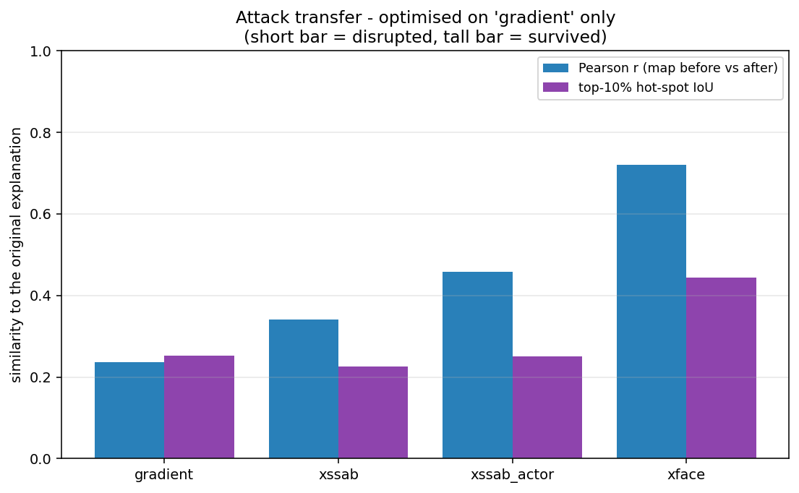

**Figure 9.** Transfer. Both map-similarity metrics rise monotonically with distance from the
optimised map, and xFace, which uses no gradients, retains most of its explanation under
both.

### 5.5 An aside on xSSAB

Measuring both variants shows the **actor map alone** scores deletion 0.1801 / insertion
0.5613, *identical* to the raw input-gradient map, while the combined actor−counteractor
map is clearly worse (0.1976 / 0.5334). Any ranking that places xSSAB last is an artefact of
scoring the combined map. `xssab_actor` is the variant to use.

---

## 6. Diagnosis: why the attack has a ceiling

§5 leaves an unexplained gap: correlation collapses, faithfulness does not. Two hypotheses,
both testable.

**H1: the budget.** The ±0.05 band shrank the perturbation on 49.9% of pairs. Perhaps the
attack was simply not allowed enough room.

**H2: the objective.** The attack minimises *correlation*, but faithfulness is a different
quantity. A face is redundant: eyes, nose bridge, mouth and jawline all carry identity, so
the attack could lower correlation by moving the ranking onto a *different set of genuinely
informative pixels*, never pointing anywhere uninformative.

### 6.1 Loosening the constraint (tests H1)

| tol | mean \|Δsim\| | shrunk | Pearson r | deletion AUC | → floor |
|---|---|---|---|---|---|
| 0.02 | 0.0118 | 88% | 0.479 | 0.1983 | 3.9% |
| 0.05 | 0.0260 | 44% | 0.220 | 0.2135 | 12.4% |
| 0.10 | 0.0462 | 14% | 0.109 | 0.2254 | 19.1% |
| 0.20 | 0.0606 | **2%** | **0.065** | 0.2298 | **21.5%** |

Loosening does buy real disruption, so H1 is not empty. But the marginal returns **saturate**
(+8.5, +6.7, +2.5 points), and at the widest band the constraint is essentially *off* (2% of
pairs shrunk, L∞ 3.95 of 4.00) with correlation already floored at 0.065. The attack still
reaches only **21.5%** of the way to the random floor.

**Both effects are real; the objective sets the ceiling.**

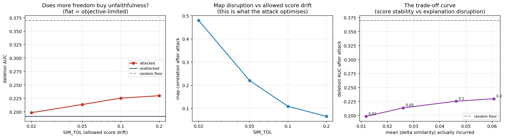

**Figure 10.** Left: deletion AUC against the allowed score drift, with the unattacked level
and the random floor marked. The curve rises but flattens, and never approaches the floor.
Middle: the quantity the attack actually optimises falls steadily to 0.065; it is not the
correlation objective that is failing to converge. Right: the two plotted against each other
is the trade-off curve between score stability and explanation disruption.

This also places earlier work on the curve: a reported correlation of 0.06 bought with a
~+0.09 score drift is the tol ≈ 0.20 point here, reaching 21.5%, no longer an incomparable
anecdote but a labelled position on a trade-off.

### 6.2 Where the saliency actually went (tests H2)

Measuring the same pairs at tol = 0.05:

- saliency mass in the off-face region: 0.239 → 0.275
- top-10% hot-spots remaining on the face: 76.9% → 72.0%
- centre-of-mass shift: **median 7.84 px** on a 112 px image

The mass stayed on the face and moved *within* it. **H2 confirmed**: the attack swapped one
identity-bearing region for another, which is exactly why correlation collapsed while
faithfulness did not.

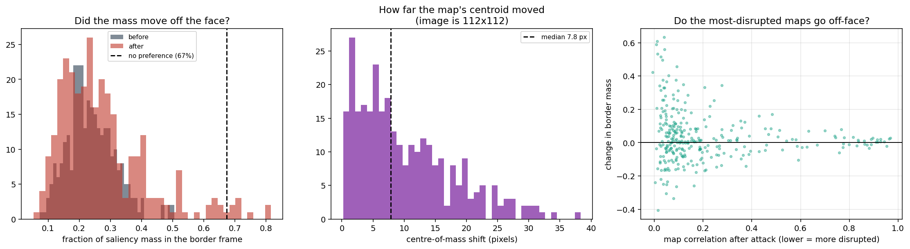

**Figure 11.** Left: the distribution of off-face saliency mass barely shifts under attack and
stays far below the no-preference line. Middle: the centre of mass moves a median of 7.8 px on
a 112 px image. Right: even the most-disrupted maps do not systematically push mass off the
face. *(Measured under the wider border-frame definition; the ellipse figures are in the text.)*

### 6.3 Attacking faithfulness directly

If the objective is the limit, an objective that *rewards* pointing at uninformative pixels
should do better. We replace the correlation term with the fraction of saliency mass falling
in an off-face region, holding everything else fixed.

The choice of region turns out to matter, and instructively so. These are ArcFace-aligned
crops in which the face fills the frame, so a border frame is a poor proxy for "background".
We report both.

| off-face region | area | mass before → after | concentration before → after | → floor | vs decorrelation |
|---|---|---|---|---|---|
| border frame | 67.3% | 0.239 → 0.614 | 0.36 → 0.91 | 19.9% | 1.61×, p = 5.6e-09 |
| **ellipse (background)** | **37.8%** | **0.053 → 0.215** | **0.14 → 0.57** | **15.4%** | 1.24×, p = 1.4e-02 |

*(concentration = mass share ÷ area share; 1.0 = no spatial preference)*

Targeting faithfulness beats decorrelation under both definitions, confirming that
correlation and faithfulness are **dissociable**, the central methodological claim,
demonstrated rather than argued. Under the frame it does so while changing the map *less* and
costing *less* score drift.

But the tighter, more defensible region makes the attack **harder**, not easier. The
unattacked explanation places only 5.3% of its mass outside the ellipse, a region covering
37.8% of the image, so a concentration of **0.14**. The explanation strongly *avoids*
background. The attack quadruples this to 0.215, but never reaches the 0.378 no-preference
line.

The reason is that an ArcFace-trained network is **invariant to background**: the
input-gradient there is intrinsically near zero, and a ±4/255 perturbation cannot manufacture
sensitivity where the model has none. The attack is fighting a learned invariance, not merely
an optimisation difficulty.

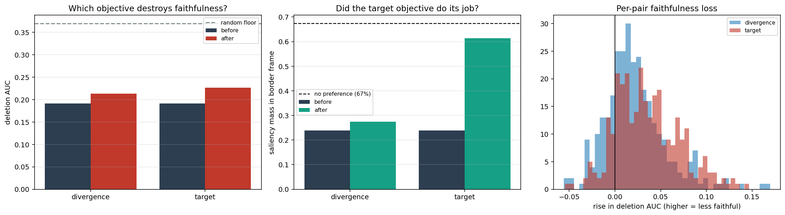

**Figure 12.** Left: both objectives lift the deletion AUC, the target objective further, but
neither reaches the random floor. Middle: the target objective does succeed at its own task:
off-face saliency mass rises sharply. Right: the per-pair distribution of faithfulness lost is
shifted right for the target objective. *(Border-frame definition; the ellipse result is in the
table above.)*

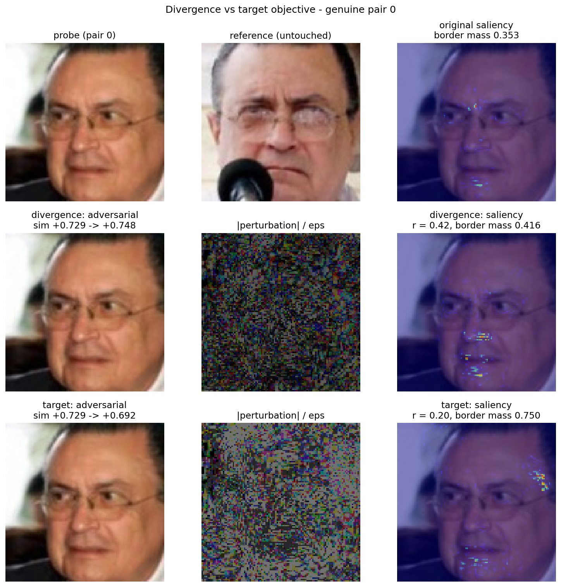

**Figure 13.** The two objectives on the same pair. Under `divergence` (middle row) the
saliency relocates from the eyes to the mouth and chin, still on the face. Under `target`
(bottom row) a visible cluster appears in the upper-right background and off-face mass more
than doubles. Both leave the photograph unchanged to the eye and the score within the band
(+0.729 → +0.748 and +0.692). This is redundancy and invariance in one picture: the attack can
move mass, but what it moves it *onto* still has to be somewhere the model looks.

---

## 7. Discussion

### 7.1 The result

Two mechanisms jointly explain the ceiling:

1. **Inside the face: redundancy.** Multiple regions carry identity, so relocating the
   ranking among them preserves faithfulness while destroying correlation.
2. **Outside the face: invariance.** The model has no gradient in background, so saliency
   mass cannot be pushed there.

Together: **the saliency map's support region is a property of the model. An imperceptible
perturbation can shuffle mass within that support, but cannot move the support itself.**

This is a positive statement about robustness, not merely a failed attack. It predicts that
explanation attacks of this form will have a structural ceiling on any model with learned
background invariance and a redundant signal, which is to say on any well-trained face
recognition system.

### 7.2 The methodological result

With correlation as the only metric, this study would have reported a successful attack on
r = 0.236. It is not one. Insertion and deletion separate *"the explanation changed"* from
*"the explanation became misleading"*, and show the first happened and the second largely did
not.

This has implications beyond this project. Correlation-based evaluation of explanation
attacks is likely to be **systematically optimistic**, and results in that literature reported
on map-similarity metrics alone should be read with that in mind.

### 7.3 A caveat in the other direction

Insertion/deletion asks whether the highlighted pixels are *informative*, not whether they are
the ones the model relied on most. Because faces are redundant, a map can relocate its
hot-spots (IoU 0.25) and remain faithful in aggregate. For a human reviewer, being told *"the
cheek drove this match"* when the model used the eyes **is** misleading, even if the cheek
also carries identity evidence.

So the honest position keeps both statements:

- by hot-spot displacement, the attack **succeeds** at changing what a human is told;
- by faithfulness, it **largely fails** to make the explanation wrong.

The gap between them is itself a finding about how explanation attacks should be evaluated,
and an argument that neither metric alone is sufficient.

### 7.4 What can and cannot be claimed

**Can be claimed.** An imperceptible perturbation to one image of a pair leaves the decision
preserved at 100% and the similarity score essentially unchanged, while relocating 75% of the
saliency map's hot-spots; the disruption is confined to gradient-based explanation methods;
and a faithfulness-based evaluation shows the relocated map remains ~89% as faithful, which
correlation-based evaluation would have missed.

**Cannot be claimed.** That the explanation was destroyed, or that a reviewer is left with a
demonstrably false justification. The evidence supports *different*, not *wrong*.

---

## 8. Limitations

- **White box.** Full gradient access to the deployed model; black-box and cross-model
  transfer untested.
- **Digital only.** No JPEG re-compression, resizing or print-scan robustness; perturbations
  are pixel-exact.
- **One model, one dataset.** LFW is near-saturated for ElasticFace-Arc: the entire error
  budget is nine pairs per side, and FMR = 10⁻³ rests on three imposter pairs. A harder
  benchmark would give a more discriminating operating curve.
- **xSSAB is our implementation** from the published paper and the reference implementation's
  documented behaviour, not the official code. Numbers should not be quoted as the authors'.
- **Masking confound.** Insertion/deletion perturbs inputs off-distribution; the random
  control bounds but does not eliminate the artefact.
- **Scope.** Only accepted genuine pairs were attacked. Corrupting the *dissimilarity*
  explanation of a rejected pair is well posed and untouched.

---

## 9. Future work

1. **Multi-method attack.** Optimise against gradient, xSSAB and a differentiable occlusion
   surrogate simultaneously. If one perturbation fools all three, the "audit with another
   family" defence disappears.
2. **Test the invariance hypothesis directly.** Measure the input-gradient magnitude in
   background regions and confirm it bounds how far saliency mass can be pushed. If it does,
   the ceiling can be *predicted* rather than merely observed.
3. **Patch-LFW** [2] for a number directly comparable to the published xSSAB evaluation.
4. **Counteractor attack** on rejected pairs.
5. **Robustness and defence.** JPEG/resize survival, and whether SmoothGrad-style averaging
   restores faithfulness under attack. Both are premature until an attack that materially
   damages faithfulness exists.

---

## 10. Conclusion

An imperceptible perturbation to one image of a verification pair can hold the decision and
the similarity score fixed while rewriting three quarters of the saliency map's hot-spots.
Judged by map correlation, the standard in this literature, that is a successful attack on
the explanation.

Judged by whether the resulting explanation is still *correct*, it is not. The attacked map
retains ~89% of its faithfulness, and neither a tenfold relaxation of the score constraint
nor an objective aimed directly at faithfulness closes more than a fifth of the gap to a
random-saliency floor. The limit is structural: redundancy inside the face lets the attack
relocate among informative pixels, and background invariance prevents it from leaving them.

The saliency map's support is a property of the model, not of the input, and an imperceptible
perturbation cannot move it. That is a more useful finding than a successful attack would have
been, and it was only visible because the explanation was evaluated for faithfulness rather
than for change.

---

## References

1. Boutros et al. *ElasticFace: Elastic Margin Loss for Deep Face Recognition.* CVPRW 2022. arXiv:2109.09416
2. Huber et al. *Efficient Explainable Face Verification based on Similarity Score Argument Backpropagation (xSSAB).* WACV 2024. arXiv:2304.13409
3. Knoche et al. *Explainable Model-Agnostic Similarity and Confidence in Face Verification.* WACVW 2023
4. Petsiuk et al. *RISE: Randomized Input Sampling for Explanation of Black-box Models.* BMVC 2018
5. Dombrowski et al. *Explanations can be manipulated and geometry is to blame.* NeurIPS 2019
6. Heo et al. *Fooling Neural Network Interpretations via Adversarial Model Manipulation.* NeurIPS 2019
7. Adebayo et al. *Sanity Checks for Saliency Maps.* NeurIPS 2018

---

*Complete numerical results, including all per-method and per-configuration tables, are in
[RESULTS.md](RESULTS.md). Notebooks 06–11 contain the executed experiments.*
